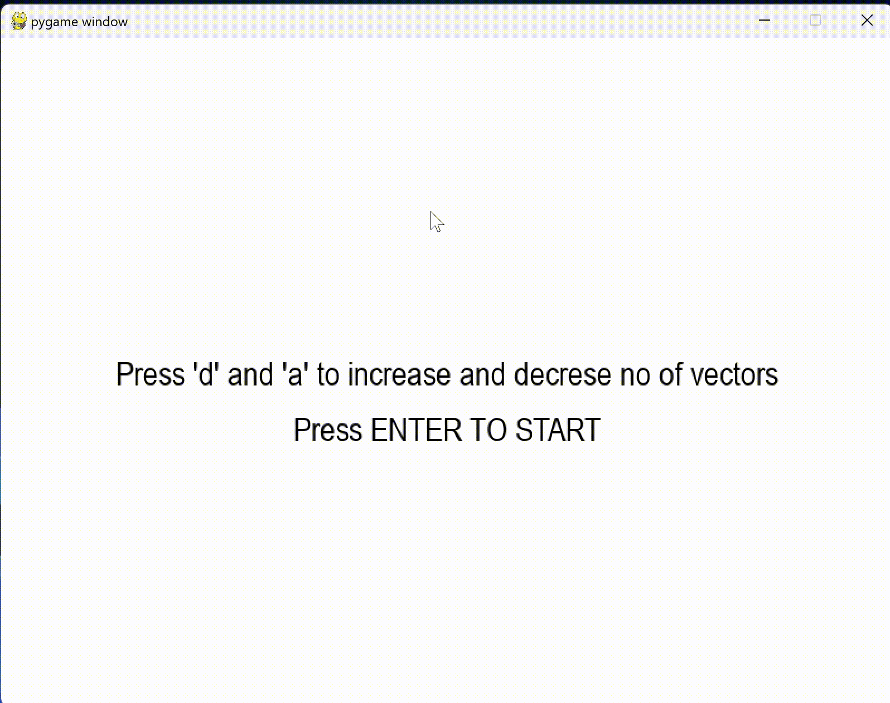

# Fourier Series Drawings with Epicycles

Draws an outline using a chain of rotating circles (epicycles) whose sizes, speeds and starting angles come from the discrete Fourier transform of the outline's points. The same idea is implemented twice: in Python with Pygame and in JavaScript with p5.js.



## Why it is interesting

Treat each point of the outline as a complex number $z_n = x_n + i y_n$ for $n = 0, \dots, N-1$. The discrete Fourier transform

$$X_k = \sum_{n=0}^{N-1} z_n e^{-2\pi i k n / N}$$

and its inverse

$$z_n = \frac{1}{N} \sum_{k=0}^{N-1} X_k e^{2\pi i k n / N}$$

say that the outline is exactly a sum of $N$ rotating vectors. Term $k$ is a circle of radius $|X_k|/N$ that turns $k$ times per cycle, starting at angle $\arg X_k$. Placing the circles tip to tail and following the end of the last one redraws the outline.

- The terms are sorted by radius, so drawing only the largest circles gives the best approximation for that many terms. The number of circles can be changed while it runs to see the approximation improve.
- Frequencies run from $0$ to $N-1$ rather than from $-N/2$ to $N/2$. Because time only advances in whole steps, frequency $k$ and $k-N$ land on the same point, so this makes no difference to the drawing.
- The DFT is written out as the direct $O(N^2)$ sum in both versions rather than calling an FFT library.

## Run it

The shapes are stored as flat lists of points, `{"points": [x0, y0, x1, y1, ...]}`. `data.json` holds the outline from `python/sign.svg` and `happy.json` the one from `python/happy.svg` (both SVGs are single polylines). There is no SVG parser; to draw another shape, put its points in a JSON file in the same format.

### Python (Pygame)

```bash
pip install pygame numpy
cd python
python main.py
```

At the prompt, type the file name without `.json` (`data` or `happy`). Press Enter to start; `d` and `a` add or remove 50 circles.

`python/testing/` holds scratch scripts that compare the hand-written DFT with `numpy.fft` (these also need matplotlib).

### JavaScript (p5.js)

`app.js` loads `/data.json` with `fetch`, so serve the `js` folder over HTTP rather than opening the file directly. p5.js is bundled.

```bash
cd js
python -m http.server 8000
```

Then open http://localhost:8000. The slider sets the number of circles.

## Tech

Python (Pygame, NumPy) and JavaScript (p5.js).

## Context

Personal project, 2022.

## License

MIT, see LICENSE.
